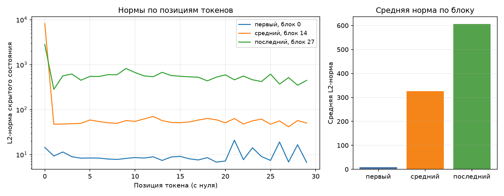

# ДЗ 2. Анатомия Qwen3-0.6B

## 1. Окружение и первый запуск

Для сохранения истории изменений использую Git.
Окружение Python 3.12 подготовил через `uv sync`; версии зависимостей
зафиксированы в `uv.lock`.

После подготовки окружения запустил исходные `make inspect` и `make check`
для ДЗ 2. Первый сформировал отчёт, второй завершился с ошибками.
Сохранил [исходные результаты](results/before-report.json),
[вывод inspect](results/before-inspect.log) и [вывод check](results/before-check.log).
Затем исправил дефекты и повторил разбор. Их причины и подтверждения
исправлений описаны в разделе 7.

Все результаты ниже относятся к **Qwen/Qwen3-0.6B**. Оставил базовую модель
из задания. Модель выбирается в `params.yaml`.

## 2. Конфигурация и параметры модели

| Параметр | Значение |
| --- | --- |
| Слоёв | 28 |
| Размер скрытого состояния | 1024 |
| Размер MLP | 3072 |
| Голов запроса | 16 |
| KV-голов | 8 |
| Размер головы | 128 |
| Размер словаря | 151 936 |
| Общие входные и выходные веса | True |

| Группа | Модулей | Shape | Уникальных параметров | Доля |
| --- | --- | --- | --- | --- |
| `embed` | 1 | 151936×1024 | 155 582 464 | 26.10% |
| `q_proj` | 28 | 2048×1024 | 58 720 256 | 9.85% |
| `k_proj` | 28 | 1024×1024 | 29 360 128 | 4.93% |
| `v_proj` | 28 | 1024×1024 | 29 360 128 | 4.93% |
| `o_proj` | 28 | 1024×2048 | 58 720 256 | 9.85% |
| `gate_proj` | 28 | 3072×1024 | 88 080 384 | 14.78% |
| `up_proj` | 28 | 3072×1024 | 88 080 384 | 14.78% |
| `down_proj` | 28 | 1024×3072 | 88 080 384 | 14.78% |
| `norm` | 113 | 128, 1024 | 65 536 | 0.01% |
| `lm_head` | 1 | 151936×1024 | 0 | 0.00% |
| **Итого** | — | — | **596 049 920** | **100%** |

Сумма таблицы — **596 049 920**, прямой подсчёт
`sum(p.numel() for p in model.parameters())` — **596 049 920**.
Они совпадают до одного параметра. Полный список имён и форм сохранён
в поле `parameter_rows` файла [report.json](report.json).

`embed_tokens` и `lm_head` используют один объект весов. Входной embedding
содержит 155 582 464 параметра. Выходная голова
имеет собственное имя и форму, но не добавляет новых весов, поэтому её
вклад в итог равен нулю. В таблице она оставлена явно.

У Qwen3 GQA: 16 голов запроса делят
8 KV-голов. Поэтому `q_proj` имеет форму
2048×1024, а `k_proj` и `v_proj` — 1024×1024.
Размер выхода Q определяется числом голов, умноженным на `head_dim`,
и не обязан совпадать с `hidden_size`.

Три проекции MLP вместе занимают
44.33% модели,
четыре проекции внимания —
29.55%.
В MLP две матрицы расширяют 1024 признака до 3072, третья сжимает обратно.
Поэтому даже без учёта embedding MLP занимает большую долю параметров.

Нормы имеют два размера: 57 векторов длины 1024 и 56 длины 128.
Их сумма: `57 × 1024 + 56 × 128 = 65 536` параметров, всего 113 модулей.
Выдавать все нормы за одинаковые векторы было бы ошибкой.

## 3. Forward-хуки и нормы активаций

Использовал промпт: «Объясни, что такое MLOps, в трёх предложениях.».
После chat template получилось 30 токенов.
Хуки поставил на выходы первого, среднего и последнего декодер-блоков.
Для каждой позиции посчитал L2-норму скрытого вектора, предварительно
отсоединив его от графа и приведя к float32.



| Блок | Индекс с нуля | Средняя L2-норма | Максимум | Позиция максимума |
| --- | --- | --- | --- | --- |
| первый | 0 | 9.675 | 20.852 | 21 |
| средний | 14 | 325.481 | 8189.664 | 0 |
| последний | 27 | 606.702 | 2815.101 | 0 |

Средние нормы в этом прогоне увеличились от первого блока к последнему.
При этом максимум среднего блока выше максимума последнего: рост средней
нормы не означает монотонный рост каждого токена. Для среднего и последнего
блоков максимум находится в позиции 0; у первого блока — в другой позиции.
Логарифмическая шкала позволяет увидеть остальные токены рядом с выбросом.

Residual-связи позволяют скрытому состоянию накапливать изменения, но сами
по себе не гарантируют роста нормы. По этому графику также нельзя доказать
attention sink: здесь измерены нормы скрытых состояний, а не веса внимания.

Для прогона временно включаю `eval` и `inference_mode`. В `finally` снимаю
только собственные хуки и восстанавливаю train/eval-флаги всех модулей,
в том числе если forward завершится с исключением.

На реальной модели число хуков до и после двух вызовов: **0 → 0 → 0**. Максимальная абсолютная разница норм между вызовами — **0.0**. Исходные train/eval-флаги восстановлены. [Численные результаты](results/diagnostics.json) и [скрипт повторного опыта](../tests/diagnose_runtime.py).

## 4. Условия замера

| Условие | Значение |
| --- | --- |
| Дата UTC | 2026-09-09T15:56:53.782441+00:00 |
| платформа | macOS-15.7.9-arm64-arm-64bit |
| ОС | Darwin 24.6.0 |
| Архитектура | arm64 |
| Модель | Qwen/Qwen3-0.6B |
| Ревизия модели | c1899de289a04d12100db370d81485cdf75e47ca |
| Устройство | mps |
| dtype базовых весов | bfloat16 |
| seq_len × batch | 256 × 1 |
| Прогонов на режим | 1 |
| Агрегация повторов | максимум пиков |
| Метрика памяти | torch.mps.driver_allocated_memory |
| Дополнительная метрика RSS | ru_maxrss |
| Python | 3.12.12 |
| torch | 2.14.0 |
| transformers | 5.16.1 |
| peft | 0.20.0 |
| Seed | 42 |
| Оптимизатор | AdamW |
| Learning rate | 1e-05 |
| LoRA для памяти | r=8, q_proj+v_proj |
| KV-cache | True |

Каждый режим запускается отдельным дочерним процессом с Python из окружения
проекта. Конфигурация передаётся в stdin, поэтому рабочая копия YAML
не меняется во время измерения. Режимы выполняются последовательно;
родитель освобождает модель перед их запуском. Вход — случайные id токенов.
Здесь оценивается память одного шага, а не качество обучения.

Замер начинается после загрузки модели и включает уже размещённые веса,
подготовку входа и весь шаг режима. Для инференса это один forward под
`inference_mode`; для обучения — forward, backward и `optimizer.step()`.
Градиенты и результат forward остаются живы до последнего замера.
Время в таблице включает загрузку модели и шаг, но не запуск интерпретатора
и импорты библиотек. Веса загружались из локального кэша, без сети.

На MPS отдельный поток опрашивает `torch.mps.driver_allocated_memory()`
каждые 10 мс. Дополнительные выборки делаются после синхронизации устройства
на границах этапов. Это **максимум наблюдавшихся значений**, а не точный
аппаратный high-water mark: очень короткий пик между выборками можно пропустить.
Метрика драйвера включает кэш аллокатора и выделения библиотек Metal,
поэтому она больше суммы живых тензоров.
[Определение метрики в PyTorch](https://docs.pytorch.org/docs/2.14/generated/torch.mps.driver_allocated_memory.html).

Для CUDA оставлен `torch.cuda.max_memory_allocated()` со сбросом счётчика
перед шагом. Для CPU используется пик RSS: `ru_maxrss` на macOS/Linux
и `peak_wset` на Windows. Эти ветки проверены адресными тестами;
фактические замеры этой работы выполнены на MPS.

Размеры в отчёте указаны в **МиБ = 1024² байта**. Поля JSON с суффиксом
`_mb` сохранены для совместимости с заданием, но также содержат МиБ.
RSS не складывается с памятью Metal: это разные способы учёта общей памяти.

## 5. Память в трёх режимах

| Режим | Пик, МиБ | Пик RSS, МиБ | × к инференсу | Время, с | PID |
| --- | --- | --- | --- | --- | --- |
| Инференс | 2221.6 | 2029.0 | 1.00 | 1.0 | 33381 |
| Full fine-tune | 6107.6 | 2032.2 | 2.75 | 2.6 | 33393 |
| LoRA (r=8, q/v) | 3603.6 | 2020.2 | 1.62 | 1.6 | 33411 |

Получено соотношение **full fine-tune > LoRA > инференс**.
Веса базовой модели занимают `596 049 920 × 2 / 1024² =
1136.875 МиБ`.
Все три пика выше этого значения. Длину 256 токенов уменьшать
не потребовалось: все режимы выполнились без нехватки памяти.

### Из чего складывается расход

Проверил dtype и размеры самих тензоров, а не только число параметров.
Градиенты учтены после backward, состояния AdamW — после первого шага,
когда они уже созданы. В таблице ниже постоянные статьи расхода;
она не включает сохранённые активации и временные буферы.

| Режим | Все веса, МиБ | Градиенты, МиБ | AdamW, МиБ |
| --- | --- | --- | --- |
| Инференс | 1136.875 | 0.000 | 0.000 |
| Full fine-tune | 1136.875 | 1136.875 | 2273.751 |
| LoRA (r=8, q/v) | 1141.250 | 4.375 | 8.750 |

В полном дообучении веса и градиенты имеют bfloat16. Два момента AdamW
тоже bfloat16; дополнительно есть маленькие float32-счётчики шагов.
Получается около `1136,875 × 4 = 4547,5 МиБ` на веса, градиенты и два момента.
Это соответствует расчёту лекции для данной реализации оптимизатора.

В LoRA peft создал адаптеры в float32: их веса занимают
4.375 МиБ, градиенты — столько же,
два момента — примерно вдвое больше. Базовые веса остались bfloat16
и заморожены. Поэтому применять «2 байта на параметр» ко всему адаптеру
было бы неверно. Подробные размеры по dtype сохранены в `components` JSON.

Разница full fine-tune и инференса — **3886.0 МиБ**;
LoRA и инференса — **1382.0 МиБ**.
При LoRA градиенты и состояния оптимизатора требуются только для адаптеров,
но обратный проход всё ещё требует промежуточных активаций.
Именно поэтому 0,192% обучаемых параметров не означают 0,192% общей памяти.

Остаток между пиком драйвера и суммой перечисленных тензоров нельзя целиком
назвать активациями: туда также входят кэш, logits, KV-cache и временные
буферы. Более того, пик и размеры отдельных компонентов могут относиться
к разным моментам шага. Поэтапные выборки сохранены в `stage_device_bytes`.

### Сопоставление с лекцией и повторной проверкой

В лекции для тех же модели, dtype, seq_len=256, batch=1 и MPS приведены
2222 / 7166 / 3606 МиБ. Мои значения —
2221.6 / 6107.6 / 3603.6 МиБ.
Одинаковый порядок режимов воспроизвёлся. Число full fine-tune отличается:
оно зависит от версии библиотек, временных буферов, синхронизации и способа
фиксации пика. Отдельный эксперимент, который выделял бы вклад каждой из
этих причин, не проводил, поэтому точную причину разницы не приписываю одной из них.

Разброс RSS между режимами составил всего
**12.0 МиБ**.
На этой машине он плохо отражает разницу расхода памяти Metal.
После исправлений `make check` независимо запустил те же три режима;
его результаты записаны в [after-check.log](results/after-check.log).

## 6. Расчёт параметров LoRA

Для одной матрицы размера `(out, in)` адаптер состоит из матриц
`A: (r, in)` и `B: (out, r)`. Число новых параметров:
`r × in + out × r = r × (in + out)`.

| r | Проекция | Слоёв | Вход | Выход | Параметров адаптера |
| --- | --- | --- | --- | --- | --- |
| 8 | q_proj | 28 | 1024 | 2048 | 688 128 |
| 8 | v_proj | 28 | 1024 | 1024 | 458 752 |
| 16 | q_proj | 28 | 1024 | 2048 | 1 376 256 |
| 16 | k_proj | 28 | 1024 | 1024 | 917 504 |
| 16 | v_proj | 28 | 1024 | 1024 | 917 504 |
| 16 | o_proj | 28 | 2048 | 1024 | 1 376 256 |
| 16 | gate_proj | 28 | 1024 | 3072 | 1 835 008 |
| 16 | up_proj | 28 | 1024 | 3072 | 1 835 008 |
| 16 | down_proj | 28 | 3072 | 1024 | 1 835 008 |

| Конфиг | Своя формула | peft | Доля базовой модели |
| --- | --- | --- | --- |
| r=8, q_proj+v_proj | 1 146 880 | 1 146 880 | 0.192% |
| r=16, все линейные | 10 092 544 | 10 092 544 | 1.693% |

Для `r=8` расчёт: `28 × 8 × ((1024 + 2048) + (1024 + 1024)) =
1 146 880`. Для `r=16` на семи проекциях: `28 × 16 ×
(3072 + 2048 + 2048 + 3072 + 4096 + 4096 + 4096) = 10 092 544`.

Обе суммы совпали с peft точно. Под «всеми линейными» здесь понимаются
семь проекций внутри декодер-блока из условия; `lm_head` в этот список
не входит. `alpha` равна `2 × r` и не добавляет обучаемых параметров.
Доля в моей таблице рассчитана от базовой модели. peft печатает процент
от модели вместе с адаптером, поэтому его процент немного меньше.

## 7. Найденные дефекты

### 1. Хуки оставались на модели

`forward_hooks` регистрировал хуки, но не сохранял handles и не вызывал
`remove()`. Первый вызов оставлял три хука, следующий добавлял ещё три.
Замыкания старых хуков продолжали хранить результаты и выполнялись снова.
Исходная проверка зафиксировала три оставшихся хука после первого вызова.

Сделал контекстный менеджер с очисткой в `finally`. Добавил временный `eval`
и восстановление исходных флагов каждого модуля. Теперь два вызова дают
ноль оставшихся хуков и одинаковые нормы. Тесты также проверяют исключение
в forward, частичную регистрацию и сохранение чужих хуков.

### 2. Tied embeddings учитывались дважды

Обход использовал `named_parameters(remove_duplicate=False)`, но все строки
помечались как независимые. Один объект попадал в сумму под двумя именами.

До исправления: **751 632 384** вместо **596 049 920**, лишние **155 582 464** параметров.

Добавил множество уже встреченных `id(param)` и пометку `tied` для повторов.
Итог после исправления — **596 049 920**, вклад `lm_head` — **0**.
Проверки охватывают и модель с общими весами, и модель с независимой головой.

### 3. Вместо пика снималось значение в конце

`PeakMemory` ничего не измерял во время шага. Единственное чтение происходило
в `__exit__`, после `gc.collect()`. После замены ошибочного RSS на текущее
значение драйвера такая реализация всё равно пропускала бы ранние максимумы.
Поэтому одной смены функции измерения было недостаточно.

Добавил фоновый опрос MPS, накопление максимума, синхронизацию и замеры
после forward, backward и optimizer step. Освобождение памяти не обнуляет
уже зарегистрированный максимум. Для CUDA используется штатный пиковый счётчик.

В отдельном диагностическом опыте создал временный тензор 64 МиБ, затем освободил его и кэш Metal. Сохранённый пик драйвера — **1042.7 МиБ**, последнее значение — **18.7 МиБ**. Размер выделений драйвера больше самого тензора из-за резервирования памяти. Это показывает, почему последнее значение не заменяет пик; опыт не входит в три основных замера.

В исходном `memory_profile` обнаружилась и связанная ошибка: режимы
выполнялись в одном процессе, хотя комментарий обещал разные процессы.
Так предыдущий максимум RSS переносился в следующий режим. Теперь каждый
`--probe` имеет отдельный PID, конфиг передаётся явно, а ошибка дочернего
процесса останавливает сборку отчёта вместо появления фиктивного числа.

### 4. На MPS читался RSS процесса

`device_allocated_bytes` и `device_metric_source` всегда вызывали `peak_rss`,
независимо от устройства. При этом подпись результата говорила «аллокатор mps».
Число и его подпись описывали разные метрики.

| Режим | До: RSS, МиБ | После: Metal, МиБ |
| --- | --- | --- |
| Инференс | 3331.5 | 2221.6 |
| Full fine-tune | 4487.8 | 6107.6 |
| LoRA (r=8, q/v) | 4487.8 | 3603.6 |

Разделил источники по устройствам и связал название метрики с фактически
вызванной функцией. Теперь на MPS в JSON и отчёте указана
`torch.mps.driver_allocated_memory`; RSS выводится отдельно.
Все пики больше веса модели, а три режима различаются.

## 8. Сводная таблица и итоговые проверки

Заполнил [anatomy-worksheet.xlsx](anatomy-worksheet.xlsx) по собственным
результатам из JSON и проверил расчёты. В исходном блоке LoRA находится
конфиг `r=8`, ниже добавлен второй блок для `r=16`. Сиреневые формулы
исходного шаблона сохранены.

Группа norm содержит векторы разных размеров, поэтому у неё нет одной
общей формы матрицы. В основной строке это обозначено явно, а ниже
добавлен отдельный расчёт для 57 и 56 векторов и сверка с общей суммой.
Для tied `lm_head` число собственных матриц равно нулю; его настоящая
форма и общий вес отражены в отчёте. На листе «Ответы» заполнены все пять вопросов.

Команды из корня репозитория:

```bash
uv sync --locked
make hw2-inspect
make hw2-test
make hw2-check
```

После исправлений [все семь проверок ДЗ 2 прошли](results/after-check.log).
[Адресные тесты](results/unit-tests.log) проверяют подсчёт общих весов,
повторные и аварийные вызовы хуков, выбор метрики, сохранение промежуточного
пика и обработку ответов дочерних процессов.

Замеры и таблицы воспроизводятся `make hw2-inspect`.
Пояснения находятся в генераторе отчёта и не исчезают при повторном запуске.
Excel заполнен по сохранённому прогону; после новых замеров его входные
ячейки нужно обновить и повторно проверить.

Локальная часть работы готова. Видео с прогоном проверок и публикация
репозитория остаются следующими этапами сдачи.

## Материалы

- [Условие ДЗ 2](../2-zadanie-dz2.html).
- [Лекция 2](../3-lekciya-2.html), слайды 12–14: параметры, LoRA и память.
- [Численные результаты текущего разбора](report.json).
- [Описание метрики MPS в PyTorch](https://docs.pytorch.org/docs/2.14/generated/torch.mps.driver_allocated_memory.html).
- [Пиковая память CUDA в PyTorch](https://docs.pytorch.org/docs/2.14/generated/torch.cuda.memory.max_memory_allocated.html).
