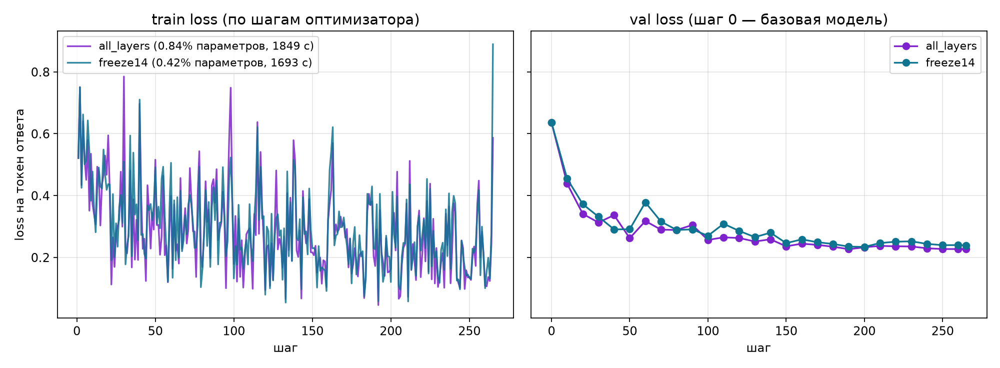

# Отчёт ДЗ 5: первый LoRA-ран на GitHub Issues

Шуликов М. В. · 4 октября 2026 года.

Обучены два LoRA-адаптера к Qwen3-0.6B на собственных тензорах ДЗ 4.
Задача — отнести GitHub issue к одному из классов `bug`, `documentation`,
`feature`, `question`, ответив только меткой. Проведена полная эпоха каждого
варианта; результаты ниже получены текущим кодом, без ограничения шагов.

## Условия и вход

Машина: Apple M4 Pro, 14 ядер CPU, 48 ГиБ общей памяти; macOS 15.7.9.
Устройство PyTorch — MPS, замороженные базовые веса — bfloat16, LoRA — float32.
Python 3.12.12, PyTorch 2.14.0,
Transformers 5.16.1, PEFT 0.20.0.
Окружение общее с ДЗ 1–4, версии зафиксированы корневым `uv.lock`.

Вход — `../HW 4/data/tokenized/train.pt` и `val.pt` версии v2 GitHub Issues:
**2114 / 268 примеров**. Это обычные последовательности, без packing;
максимальная длина — 1792. Промпт маскирован `-100`, padding добавляется слева.
За эпоху обрабатываются **772903 входных токена**, из них **6341** участвуют
в train loss; validation содержит **804 токена ответа**.

Модель: `Qwen/Qwen3-0.6B`, ревизия `c1899de289a04d12100db370d81485cdf75e47ca`.
LoRA: r=8, alpha=16, dropout=0.05, семь проекций внимания и MLP.
Seed 42, lr 2e-4, одна эпоха, microbatch 2 × grad_accum 4,
warmup 3%, cosine schedule, clip_grad_norm=1. Gradient checkpointing включён.
В `params.yaml` стоит `max_steps: null`.

## Сравнение вариантов

| Показатель | all_layers | freeze14 |
|---|---:|---:|
| Слои с LoRA | 0–27 | 14–27 |
| Обучаемых параметров | 5,046,272 | 2,523,136 |
| Доля обучаемых | 0.84% | 0.42% |
| Шагов / примеров | 265 / 2114 | 265 / 2114 |
| Val до обучения | 0.636233 | 0.636233 |
| Val на шаге 265 | 0.226786 | 0.238834 |
| Время обучения, с | 1849.4 | 1692.8 |
| Время валидации, с | 1021.0 | 935.3 |
| Секунд / обновление | 6.979 | 6.388 |
| Токенов входа / с обучения | 417.9 | 456.6 |
| Наблюдаемый пик MPS, МиБ | 6427.7 | 5427.7 |
| Матрицы адаптера, МиБ | 19.3 | 9.65 |
| Папка с токенизатором, МиБ | 30.21 | 20.56 |

У freeze14 вдвое меньше обучаемых параметров. Наблюдаемое изменение времени
обучения у freeze14 относительно all_layers: **ниже на 8.5%**; памяти: **ниже на 15.6%**.
Размеры указаны в МиБ (2²⁰ байт), поэтому матрицы all_layers около 20,2 МБ
в десятичном исчислении соответствуют примерно 19,3 МиБ. Папка больше
матриц, потому что включает токенизатор и шаблон.

## Кривые и вывод



Validation измеряется до обучения и каждые десять обновлений, включая
последнее: **28 точек на всех 268 примерах**. База — точка 0, где матрица B
адаптера ещё нулевая. Средний train loss первых 53 шагов all_layers равен
**0.3799**, последних 53 — **0.2203**. Финальные val loss обоих
вариантов приведены в таблице; именно по ним сравнивается адаптер с базой.

Данные размечены по labels GitHub, поэтому содержат шум. Снижение loss
доказывает сходимость данного обучения; оно само по себе не доказывает
качество классификации в новых проектах. Для сравнения времени выполнен
один прогон каждого варианта, доверительные интервалы не оценивались.

## Пять фиксированных примеров

В [compare.md](compare.md) показаны пять issue из validation с исходными
метками и реальными ответами базы и all_layers. Медицинские вопросы
из шаблона заменены на собственную тему. Генерация жадная, максимум 16
новых токенов; система просит вернуть только одну категорию.

Дословное совпадение с метками этих пяти примеров: **база 3/5,
адаптер 4/5**. Это иллюстрация подключения адаптера, а не полноценная
оценка качества; она не заменяет независимый тест следующей работы.

## Воспроизводимость и хранение

Отпечаток входов обучения: **9da9ff4a4ff7**. Он учитывает код,
обучающие параметры, lock-файл и фактические тензоры. Изменение входов
во время обучения блокирует сохранение. SHA-256 исходных файлов:

```text
train.pt 433d2f471bf4d483ffcc5ed22b33a7dd633b36aab4fdb04a53f6fa3b8546c714
val.pt   c6ddb80678192229358b835580600b69671ec249e19fa75305fcd353d0186633
```

В DVC объявлены `train_all`, `train_freeze`, `plot`, `compare`; данные и код
перечислены в зависимостях. Стадия tokenize ДЗ 4 является предыдущим звеном.
Веса адаптеров и JSON-метрики хранятся через DVC и исключены из Git.
В Git входят исходники, конфигурация, DVC lock, этот отчёт,
[разбор дефектов](defects.md), график и сравнение.

Из папки `HW 5`:

```bash
make install
make test
make repro
make check
```

`make repro` восстанавливает или пересчитывает стадии по DVC; для принудительного
повторного эксперимента — `uv run --project .. --locked dvc repro --force`.
Базовая модель должна быть доступна в локальном HF-кеше при работе офлайн.
В папке адаптера находятся токенизатор, chat template, имя/ревизия базы и
`inference_config.json`.

## Проверка результата

Шесть дополнительных тестов прошли. Исходный `tests/check.sh` сохранён
побайтово; отпечаток **06a02208c1f0**. Полный журнал обучения —
[train.log](train.log), результат приёмки — [check.log](check.log).
Все девять исходных проверок прошли. Пять ответов при офлайн-загрузке совпали дословно. Два независимых запуска по три шага дали одинаковую train-кривую **[0.5211, 0.7505, 0.3954]**.
